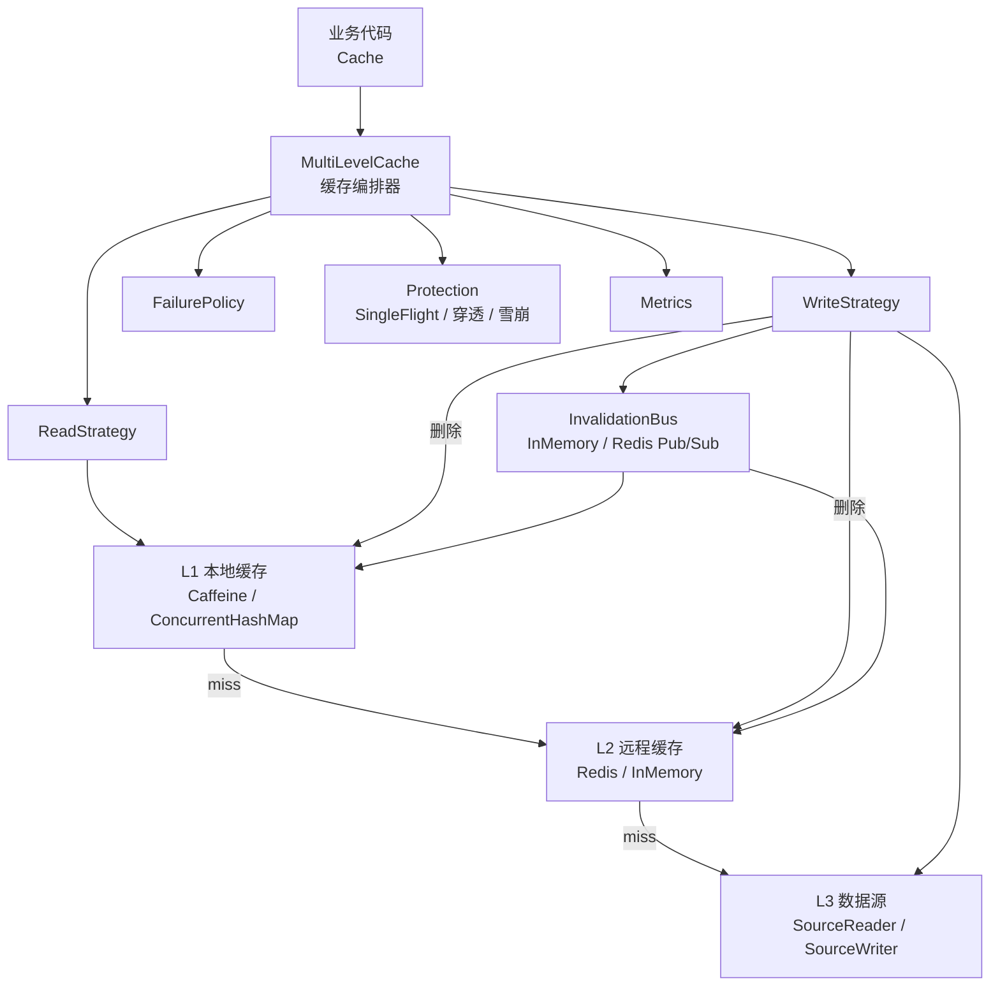

# hyg-cache

> 一个可插拔的多级缓存编排框架。
>
> 基于 Java 17，参考 JetCache 的多级缓存设计，提供 `L1 本地缓存 + L2 远程缓存 + L3 数据源` 的统一读写链路，并把缓存一致性、并发回源和故障降级拆成可替换组件。

[](https://www.oracle.com/java/)
[](https://github.com/ben-manes/caffeine)
[](https://redis.io/)
[](./LICENSE)

## 为什么做这个项目

多级缓存真正困难的地方不在于把数据放进 Redis，而在于处理缓存层之间的失效、并发和故障：

- 多个应用实例各自维护本地缓存，数据更新后如何通知其他实例？
- 同一个热点 Key 同时失效时，如何避免大量请求同时回源？
- 失效消息重复、乱序或延迟到达时，如何避免旧数据覆盖新数据？
- Redis 暂时不可用时，是否可以返回旧值或从数据源恢复？

`hyg-cache` 将这些问题拆成策略、事件总线、防护组件和指标组件，业务代码只依赖统一的 `Cache<K, V>` 接口。

本项目的目标是通过实现和验证这些设计，理解多级缓存的工程取舍。它是 JetCache 的学习型实现，不替代 JetCache，也没有复用 JetCache 源码。

## 核心能力

| 能力 | 说明 |
| --- | --- |
| 多级读取 | L1 Caffeine/ConcurrentHashMap → L2 Redis → L3 数据源，并按层回填 |
| Cache Aside 写入 | 更新数据源后删除缓存，再广播失效事件 |
| 延迟双删 | 通过可选装饰器降低读线程晚回填旧值的概率 |
| 版本化失效 | `eventId` 处理重复事件，`version` 处理乱序事件，指纹校验避免事件冲突 |
| SingleFlight | 合并同一 Key 的并发回源请求，降低缓存击穿时的数据源压力 |
| 穿透防护 | 布隆过滤器与短 TTL 空值占位 |
| 雪崩防护 | TTL 随机抖动，避免大量 Key 同时过期 |
| 故障降级 | 通过 `FailurePolicy` 选择失败处理方式，可使用旧值兜底 |
| 可插拔 | 读写策略、失效总线、序列化、指标和防护组件均通过接口注入 |
| 轻量核心 | 不依赖 Spring；核心实现基于 JDK、Caffeine、Lettuce 和 Jackson |

## 架构



### 读取链路

```text
get(key)
  ├─ L1 命中：直接返回
  ├─ L1 未命中，L2 命中：回填 L1 后返回
  └─ L2 未命中：SingleFlight 合并请求，读取 L3
       ├─ L3 返回值：回填 L2 和 L1 后返回
       └─ L3 返回空：写入短 TTL 空值占位，返回 Optional.empty()
```

### 写入链路

```text
put(key, value)
  1. 更新 L3 数据源并取得新版本号
  2. 删除 L2
  3. 删除当前实例的 L1
  4. 发布失效事件，通知其他实例删除本地 L1
  5. 可选：延迟一段时间后再次删除缓存
```

### 失效事件链路

```text
实例 A 更新数据
      ↓
发布 CacheInvalidationEvent
      ↓
其他实例收到事件
      ↓
eventId 去重 → 指纹校验 → version 比较
      ↓
删除对应 L1/L2 条目
```

`Redis Pub/Sub` 适合演示跨实例通知，但属于尽力而为的通道。生产环境可以把 `InvalidationBus` 替换为 Kafka、RocketMQ，或接入 Outbox/CDC 做可靠投递和补偿。

## 快速开始

### 环境要求

- JDK 17+
- Maven 3.8+
- Docker（运行 Redis 集成测试时需要）

### Maven 依赖

```xml
<dependency>
    <groupId>io.github.ooohyg</groupId>
    <artifactId>ooohyg-distributed-components</artifactId>
    <version>0.1.0-SNAPSHOT</version>
</dependency>
```

当前依赖由 Maven 传递引入：

- Caffeine `3.1.8`
- Lettuce `6.3.2.RELEASE`
- Jackson Databind `2.17.2`

### 内存版示例

内存实现适合学习和单元测试。生产环境只需要把 L2 和失效总线替换为 Redis 实现。

```java
CacheLevel<String, String> l1 = new CaffeineL1Cache<>();
CacheLevel<String, String> l2 = new InMemoryL2Cache<>();

InMemorySourceReader<String, String> source = new InMemorySourceReader<>();
InMemoryInvalidationBus bus = new InMemoryInvalidationBus();
SimpleCacheMetrics metrics = new SimpleCacheMetrics();

Cache<String, String> cache = new MultiLevelCache<>(
        l1,
        l2,
        source,
        source::put,
        new CacheAsideReadStrategy<>(new SingleFlight<>()),
        new CacheAsideWriteStrategy(),
        bus,
        metrics
);

source.put("user:1", "Alice");
System.out.println(cache.get("user:1")); // Optional[Alice]

cache.put("user:1", "Alice2");
System.out.println(cache.get("user:1")); // Optional[Alice2]
```

### Redis 版组装方式

```java
RedisClient client = RedisClient.create("redis://localhost:6379");
RedisCodec<String, byte[]> codec =
        RedisCodec.of(StringCodec.UTF8, ByteArrayCodec.INSTANCE);

StatefulRedisConnection<String, byte[]> l2Connection = client.connect(codec);
RedisCommands<String, byte[]> l2Commands = l2Connection.sync();
StatefulRedisPubSubConnection<String, byte[]> pubSub = client.connectPubSub(codec);

ObjectMapper mapper = new ObjectMapper();
JacksonCacheSerializer<String> cacheSerializer =
        new JacksonCacheSerializer<>(mapper, String.class);
JacksonEventSerializer eventSerializer = new JacksonEventSerializer(mapper);

RedisL2Cache<String, String> l2 = new RedisL2Cache<>(
        l2Commands,
        cacheSerializer,
        "app:user:",
        Function.identity(),
        "RedisL2Cache"
);

RedisPubSubInvalidationBus bus = new RedisPubSubInvalidationBus(
        l2Commands,
        pubSub,
        eventSerializer,
        "app:cache:invalidation"
);

Cache<String, String> cache = new MultiLevelCache<>(
        new CaffeineL1Cache<>(),
        l2,
        source,
        source::put,
        new CacheAsideReadStrategy<>(new SingleFlight<>()),
        new CacheAsideWriteStrategy(),
        bus,
        new SimpleCacheMetrics()
);
```

## 模块职责

### API 抽象

| 接口 | 职责 |
| --- | --- |
| `Cache<K, V>` | 业务门面，只暴露业务需要的值 |
| `CacheLevel<K, V>` | 单层缓存抽象，L1 和 L2 均可实现 |
| `SourceReader<K, V>` / `SourceWriter<K, V>` | L3 数据源读写 |
| `ReadStrategy` / `WriteStrategy` | 可替换的读写流程 |
| `FailurePolicy` | 定义缓存层或数据源失败时的处理方式 |
| `CacheSerializer` | 缓存值序列化与反序列化 |
| `InvalidationBus` | 发布和订阅缓存失效事件 |

### 核心编排

| 类 | 职责 |
| --- | --- |
| `MultiLevelCache` | 组装各层缓存、数据源、策略和扩展组件 |
| `SingleFlight` | 合并同一 Key 的并发加载请求 |
| `DelayedTaskScheduler` | 执行延迟任务，支持延迟双删和防抖 |

### 数据模型

| 类型 | 作用 |
| --- | --- |
| `VersionedValue` | 数据源中的值与版本号 |
| `CacheEntry` | 缓存中的值、版本、过期时间和空值标记 |
| `CacheInvalidationEvent` | 携带 `eventId`、Key、版本和指纹的失效事件 |
| `EventType` | `INVALIDATE`、`PUT` 等事件类型 |

### 具体实现

| 模块 | 教学实现 | 生产适配 |
| --- | --- | --- |
| L1 | `ConcurrentHashMapL1Cache` | `CaffeineL1Cache` |
| L2 | `InMemoryL2Cache` | `RedisL2Cache` |
| 数据源 | `InMemorySourceReader` | 业务自己的数据库或远程服务适配器 |
| 失效总线 | `InMemoryInvalidationBus` | `RedisPubSubInvalidationBus` |
| 序列化 |  | `JacksonCacheSerializer`、`JacksonEventSerializer` |
| 指标 | `NoOpCacheMetrics` | `SimpleCacheMetrics` |

## 关键设计

### `Cache` 和 `CacheLevel` 返回值不同

业务代码只关心数据是否存在，因此 `Cache.get` 返回 `Optional<V>`。

编排器还需要判断版本、TTL 和空值占位，所以底层 `CacheLevel.getEntry` 返回 `Optional<CacheEntry<V>>`。业务接口和内部元数据由此解耦。

### 为什么使用 `eventId + version`

失效事件可能重复到达，也可能乱序到达：

- `eventId`：同一个事件重复消费时只处理一次；
- 指纹：相同事件 ID 携带不同内容时拒绝处理，避免事件冲突；
- `version`：旧版本事件晚到时不能覆盖新版本状态。

这三个字段分别处理重复、篡改或冲突、乱序三个问题。它们不能替代可靠消息投递，消息可靠性仍需要 MQ、Outbox 或 CDC 支撑。

### 为什么优先删除缓存

写入时采用“更新数据源，再删除缓存”：

1. 数据源是最终事实来源；
2. 删除比计算并更新缓存更简单；
3. 下次读取会按最新数据重新回填；
4. 可以减少并发更新导致旧值覆盖新值的窗口。

在高并发读写下，单次删除仍存在旧值回填窗口，因此提供延迟双删装饰器。它用于降低风险，不能单独宣称实现严格强一致。

### 三层 TTL 各自负责什么

| 层级 | 配置位置 | 作用 |
| --- | --- | --- |
| 业务 TTL | `MultiLevelCache` | 控制业务数据可以缓存多久 |
| L1 TTL | `CaffeineL1Cache` | 控制单实例内存占用和本地数据新鲜度 |
| L2 TTL | `RedisL2Cache` | 控制远程缓存生命周期，通常可增加缓冲时间 |

L1 TTL 通常短于 L2 TTL，避免本地实例长期保留旧数据；真正需要跨实例同步时，依赖失效事件和版本校验。

### SingleFlight 与分布式锁的边界

`SingleFlight` 只合并同一 JVM 内的并发回源请求。多实例部署时，每台机器仍可能各自回源，因此跨 JVM 的击穿保护需要接入 `CacheBreakdownGuard`，例如由业务侧使用 Redisson 或其他分布式协调组件实现。

分布式锁也不是最终正确性来源。重要写入仍应使用数据库唯一约束、条件更新、业务状态机或版本校验兜底。

## 与 JetCache 的关系

### 参考的设计思想

- 多级缓存逐层查找与回填；
- Loader 驱动的自动加载；
- 缓存实例和管理器的职责划分；
- 本地缓存与远程缓存组合。

### 本项目的扩展方向

- `CacheEntry` 携带版本、TTL 和空值标记；
- `ReadStrategy` / `WriteStrategy` 把读写流程显式抽象出来；
- `FailurePolicy` 负责故障时返回旧值、跳过缓存层或抛出异常；
- L3 数据源作为一等抽象参与编排；
- 通过装饰器组合延迟双删、穿透防护等能力；
- 使用 `eventId + version + fingerprint` 处理事件幂等与乱序。

本项目没有复制 JetCache 源码。JetCache 使用 Apache 2.0 许可证，相关说明见 [NOTICE](./NOTICE)。

## 当前实现状态

### 已实现

- [x] L1 → L2 → L3 三级读取与逐层回填
- [x] Cache Aside 写路径
- [x] 延迟双删装饰器
- [x] `eventId` 幂等、指纹校验和 `version` 乱序检测
- [x] SingleFlight 并发合并
- [x] Caffeine L1 与 ConcurrentHashMap L1
- [x] Lettuce Redis L2
- [x] Redis Pub/Sub 跨实例失效广播
- [x] 三层 TTL 配置与 TTL 抖动
- [x] 空值缓存与内存布隆过滤器
- [x] `FailurePolicy` 降级和旧值兜底
- [x] Testcontainers + Redis 集成测试
- [x] 可直接运行的内存演示程序（6 个场景 + 汇总表，见下节）

### 当前边界

- [ ] `CacheBreakdownGuard` 只有接口，尚未内置 Redisson 实现
- [ ] 热点 Key 保护尚未实现
- [ ] 逻辑过期和后台刷新尚未实现
- [ ] 熔断、限流和完整超时策略尚未接入
- [ ] Redis Pub/Sub 是尽力而为通道，不保证失效事件持久化
- [ ] Outbox、定时对账和自动补偿尚未实现
- [ ] 指标目前是内存实现，尚未接入 Micrometer
- [ ] 日志仍需统一为 SLF4J 结构化日志
- [ ] 布隆过滤器为内存实现，重启后需要重新构建

## 可运行演示（Demo）

仓库自带一个纯内存、可直接运行的演示程序 `CacheDemo`，把六条核心链路完整跑一遍：**不需要 Redis、不需要 Docker、不需要任何外部配置**。

- 源码位置：`src/main/java/io/github/ooohyg/distributed/cache/demo/CacheDemo.java`
- 主类：`io.github.ooohyg.distributed.cache.demo.CacheDemo`
- 组件组装：L1 = `ConcurrentHashMapL1Cache`，L2 = `InMemoryL2Cache`，数据源 = 内存实现（同时实现 `SourceReader` / `SourceWriter`），失效总线 = `InMemoryInvalidationBus`，指标 = 演示用计数实现（打印命中、回源、失效次数）

### 运行

一条命令即可（编译并运行 `demo` 包下的 `CacheDemo`）：

```bash
mvn compile exec:java
```

主类已在 `pom.xml` 的 `exec-maven-plugin` 中通过属性 `exec.mainClass` 配置好，不需要手工拼 classpath，也不需要本地安装 Redis。

需要临时换主类或追加参数时：

```bash
mvn compile exec:java -Dexec.mainClass=io.github.ooohyg.distributed.cache.demo.CacheDemo
```

也可以在 IDE 中直接运行 `CacheDemo#main`，Maven 会自动带上依赖。

> 终端是 GBK 代码页的 cmd 时，如看到中文乱码先执行 `chcp 65001`（程序内部已固定按 UTF-8 输出）。

<details>
<summary>备选：不使用 exec 插件，手工拼 classpath 运行</summary>

```bash
mvn -q -DskipTests compile
mvn -q org.apache.maven.plugins:maven-dependency-plugin:3.8.1:build-classpath -Dmdep.outputFile=target/demo-classpath.txt
java -Dfile.encoding=UTF-8 -cp "target/classes:$(cat target/demo-classpath.txt)" io.github.ooohyg.distributed.cache.demo.CacheDemo
```

Windows PowerShell：

```powershell
mvn -q -DskipTests compile
mvn -q org.apache.maven.plugins:maven-dependency-plugin:3.8.1:build-classpath "-Dmdep.outputFile=target/demo-classpath.txt"
$cp = "target\classes;" + (Get-Content target\demo-classpath.txt -Raw).Trim()
java "-Dfile.encoding=UTF-8" -cp $cp io.github.ooohyg.distributed.cache.demo.CacheDemo
```

</details>

### 演示内容

| 场景 | 演示内容 | 观察点 |
| --- | --- | --- |
| 1 | 冷读穿透回源 + 逐层回填 | 首次 `get` 回源并回填 L2 / L1；二次 `get` 命中 L1，回源次数不再增长 |
| 2 | 并发同 Key 回源合并 | 16 个线程同时读同一 Key，L3 只被调用 1 次，SingleFlight 合并 15 次 |
| 3 | 空值占位防穿透 | 查询不存在的 Key 只回源 1 次，后续命中空值占位直接返回 `Optional.empty()` |
| 4 | 写触发清除 + 失效广播 | 实例 A 写入后 A / B 的 L1 与共享 L2 全部被清除，B 重新读取拿到新值 |
| 5 | 旧版本失效事件被丢弃 | 晚到的低版本事件被忽略、L1 保留；新版本事件正常清除 |
| 6 | 源故障降级返回旧值 | 数据源抛异常时用旧值兜底返回，业务侧不感知异常 |

每个场景输出分段标题、链路说明和关键指标（回源次数、命中情况、耗时），最后打印汇总表（各场景结果、L3 回源次数、命中率）。

> 说明：场景 2 与场景 5 的请求均为首次访问（并发冷读、失效后重建），命中率为 0 属于预期结果，不代表缓存未生效。

## 构建与测试

```bash
mvn -q clean compile
mvn -q test
```

测试覆盖的主要场景：

- L1 命中、L2 命中回填 L1、L3 回源回填 L2 和 L1；
- 同一 Key 的并发回源合并；
- 不同 Key 的并发加载；
- Redis 不可用时的降级；
- Loader 超时；
- 重复和乱序失效事件；
- 失效事件指纹冲突；
- 空值缓存命中；
- 布隆过滤器误判；
- TTL 抖动范围。

## 路线图

1. 完善 `FailurePolicy`，增加统一超时、熔断和限流；
2. 接入 Micrometer 与 SLF4J 结构化日志；
3. 增加可靠失效通道、Outbox 和定时对账；
4. 实现逻辑过期、后台刷新和热点 Key 保护；
5. 增加 JMH 基准测试与 Redis 故障演练；
6. 接入 `ooohyg-agent`，验证 Agent 会话和工具结果缓存；
7. 拆分 `core`、`local`、`remote`、`starter` 多模块。

## License

本项目基于 Apache License 2.0 发布，详见 [LICENSE](./LICENSE)。

感谢以下项目提供的工程参考：

- [JetCache](https://github.com/alibaba/jetcache)
- [Caffeine](https://github.com/ben-manes/caffeine)
- [Lettuce](https://github.com/redis/lettuce)
- [Jackson](https://github.com/FasterXML/jackson)
